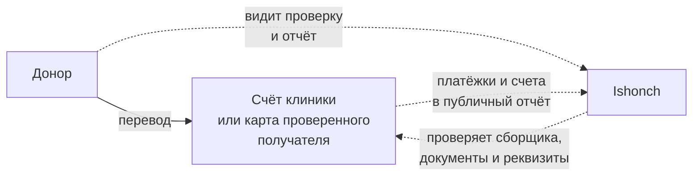
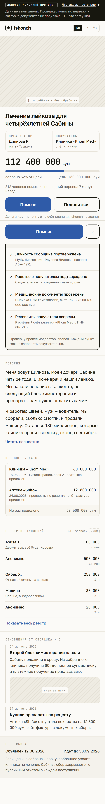
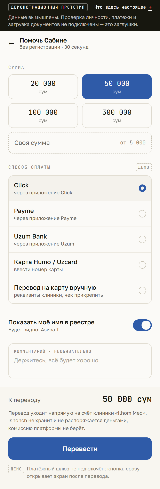
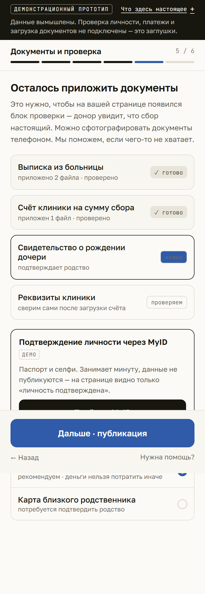
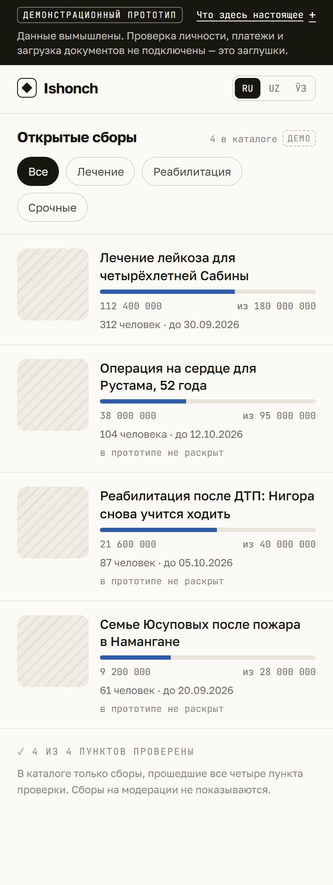
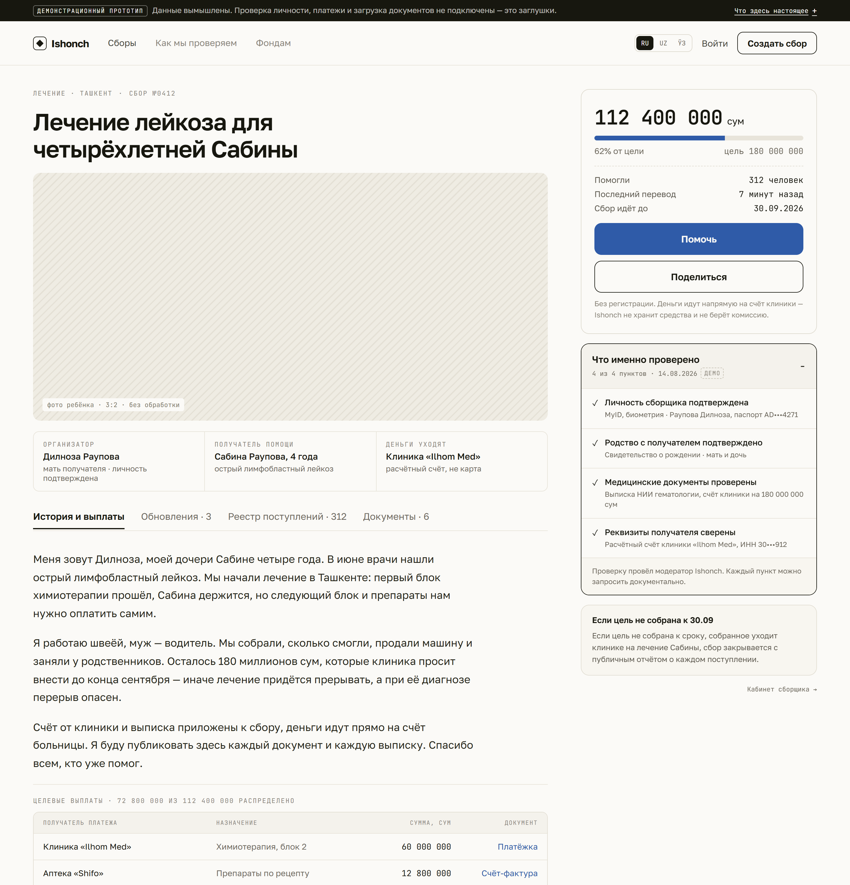
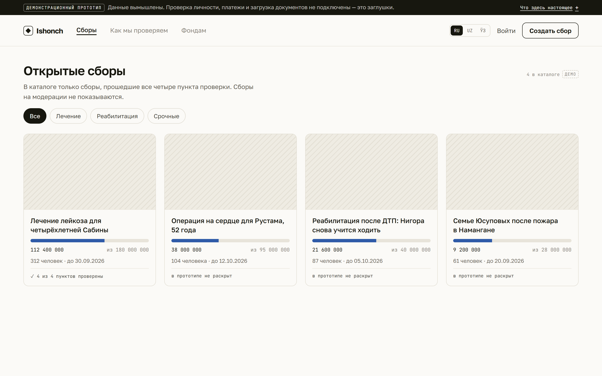
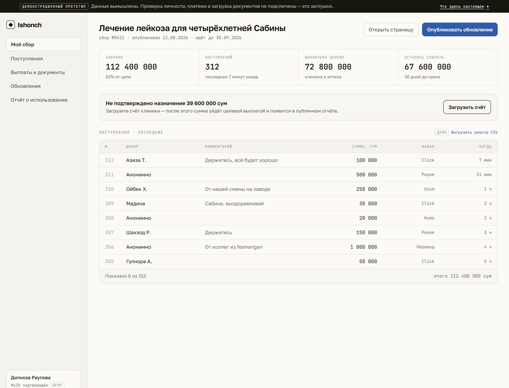

# Ishonch

**Платформа адресных сборов на лечение и социальную помощь в Узбекистане.**
Ishonch не держит деньги. Донат уходит напрямую на счёт клиники или на карту верифицированного получателя. Мы — слой проверки, публичного объявления сбора и отчётности о расходовании.

Это pre-MVP: работающий прототип интерфейса на реальной продуктовой логике. Внешние интеграции не подключены и честно помечены в самом интерфейсе — см. [Что реализовано и что заглушка](#что-реализовано-и-что-заглушка).

---

## Проблема

Сборы на лечение в Узбекистане живут в Telegram и Instagram. Выглядит это одинаково: пост с фотографией, диагноз, номер карты в комментариях. У человека, который хочет помочь, нет ни одного способа проверить главное:

- существует ли болезнь и та ли это сумма, что просит клиника;
- имеет ли сборщик отношение к получателю помощи;
- дошли ли деньги до лечения, а не до чужой карты.

Из-за этого происходит две вещи сразу. Настоящие сборы собирают медленнее, чем нужно по срокам лечения. А доноры, однажды столкнувшиеся с мошенничеством, перестают переводить вообще — включая тем, кому действительно нужно.

Ishonch продаёт не удобство перевода. Перевести деньги в Узбекистане и так легко. Мы продаём уверенность, что сбор настоящий и деньги дойдут.

## Почему сейчас

С **23 ноября 2025 года** действует Закон Республики Узбекистан «О благотворительности» в редакции **ЗРУ-1083**. Он меняет правила игры для того, как сборы устроены сегодня:

- физическому лицу запрещено собирать средства в интересах третьих лиц;
- запрещено публиковать номера своих карт для сбора средств;
- сборщик обязан заранее объявлять цель, срок и сумму сбора и раскрывать, как собранные средства использованы.

То есть привычная схема «пост с номером карты» стала прямо противоречить закону. При этом легального инструмента, который делал бы то же самое по правилам, на рынке нет: сборы либо остаются в мессенджерах вне закона, либо не происходят вовсе.

Ishonch — этот инструмент. Продукт спроектирован под требования закона не как надстройка, а как основа: объявление цели, срока и суммы, проверка связи сборщика с получателем, прямая выплата получателю, публичный отчёт о каждом поступлении и каждой выплате.

> Юридическая модель описывается отдельно в `docs/legal-model.md`. Формулировки требований в этом README даны в том виде, в котором они сформулированы в модели; ссылок на конкретные статьи мы здесь не приводим.

## Как движутся деньги

Ключевое архитектурное решение: **платформа не является получателем платежа ни на одном шаге.**



Сплошная линия — это движение денег. Пунктир — это то, что делает Ishonch: проверяет, объявляет и показывает. Денежная линия платформу не пересекает.

Что из этого следует для продукта:

- **Нет балансов, счетов и кнопок вывода.** Интерфейс нигде не выглядит как кошелёк — это не стилистическое решение, а следствие модели.
- **Нет комиссии с перевода.** Платформе нечего удерживать: она не участвует в платеже.
- **Реквизиты получателя — часть проверки.** Мы сверяем расчётный счёт клиники и показываем донору, что деньги уходят на счёт, а не на карту.
- **Организатор и получатель на странице разделены.** Закон разрешает собирать для себя или для близкого родственника, поэтому связь между ними видна донору до перевода, а не спрятана в описании.

## Блок проверки — ядро продукта

На странице сбора это единственный элемент, который не свёрнут. Он не бейдж с галочкой: галочка сообщает вывод, а мы продаём основания.

Четыре пункта, каждый с указанием, чем именно он подтверждён:

1. **Личность сборщика подтверждена** — MyID, биометрия.
2. **Родство с получателем подтверждено** — документ о родстве.
3. **Медицинские документы проверены** — выписка и счёт клиники на сумму сбора.
4. **Реквизиты получателя сверены** — расчётный счёт и ИНН организации-получателя.

Любой пункт донор может запросить документально. Сбор, не прошедший все четыре пункта, в каталоге не показывается.

## Скриншоты

Основной вход в продукт — ссылка из Telegram, поэтому мобильные экраны первичны.

### Страница сбора · 390



### Донат и создание сбора · 390

 

### Каталог · 390



### Десктоп · 1440







## Что реализовано и что заглушка

Без умалчиваний. Всё, что перечислено в правой колонке, помечено в интерфейсе монотипным чипом `демо` и полосой над шапкой.

### Реализовано

| Что | Где |
| --- | --- |
| Страница сбора целиком: сумма и прогресс, блок проверки с раскрытием, история, целевые выплаты с нераспределённым остатком, реестр поступлений, обновления от сборщика, срок сбора, липкая нижняя панель | `src/screens/CampaignScreen.tsx` |
| Поток доната: пресеты, своя сумма с минимумом, пять способов оплаты, переключатель анонимности, комментарий, пересчёт итога | `src/screens/DonateScreen.tsx` |
| Экран после перевода: квитанция, обновлённая сумма сбора, шер весом не меньше самого доната | `src/screens/DonateSuccessScreen.tsx` |
| Шестишаговое создание сбора: получатель, история, сумма, срок, документы и проверка, публикация | `src/screens/CreateScreen.tsx` |
| Каталог с фильтрами и карточками прогресса | `src/screens/CatalogScreen.tsx` |
| Кабинет сборщика: показатели, предупреждение о нераспределённой сумме, реестр поступлений | `src/screens/DashboardScreen.tsx` |
| Донат в демонстрации действительно дописывается в реестр и увеличивает собранную сумму | `src/store.tsx` |
| Копирование ссылки на сбор — единственное действие «поделиться», которое работает по-настоящему | `src/lib/hooks.ts` |
| Дизайн-токены макета в одном месте: палитра, типографика, радиусы, отступы | `src/styles/tokens.css` |
| Все строки интерфейса в одном словаре | `src/i18n/ru.ts` |

### Заглушки

| Что | Как ведёт себя в прототипе |
| --- | --- |
| **MyID** — подтверждение личности и биометрия | Кнопка сообщает, что это заглушка. Показанные данные (`паспорт AD•••4271`) вымышлены |
| **Click, Payme, Uzum Bank, Humo / Uzcard, перевод вручную** | Способ выбирается, платёжный шлюз не подключён. «Перевести» сразу открывает экран после перевода |
| **Загрузка документов и фотографий** | Кнопки помечены как заглушки, файлы не принимаются. Сканы и фото — диагональная штриховка, а не изображения |
| **Работа модератора** | Проверка не проводится: блок проверки показывает заранее заданный результат |
| **SMS, вход, регистрация** | Нет вовсе. «Войти» — неактивный элемент шапки |
| **Отчёт и выгрузка CSV** | Ссылки показаны, файл не формируется |
| **Остальные сборы каталога** | Раскрыта одна страница — сбор Сабины. Остальные карточки помечены `в прототипе не раскрыт` |
| **Переключатель RU / UZ / ЎЗ** | Присутствует визуально, язык не переключает. Строки вынесены в словарь, чтобы локализация добавлялась файлом-соседом |
| **Все данные на экранах** | Вымышлены. Реальных людей, клиник и сборов в прототипе нет |

### Чего нет намеренно

Бэкенда, аутентификации, базы данных, админки, тестов, CI, аналитики, тёмной темы, PWA. Pre-MVP отвечает на вопрос «убеждает ли продукт донора», а не «выдержит ли он нагрузку».

### Выдуманные метрики убраны

В hi-fi макете были две цифры, за которыми нет данных: «Один шер приводит в среднем 4 перевода» на экране после перевода и «128 проверенных» в каталоге. Обе убраны. Каталог показывает фактическое число сборов в нём, экран после перевода — формулировку без числа. Ничего подобного в прототипе не добавлено.

## Запуск локально

Нужен Node.js 18 или новее.

```bash
npm install && npm run dev
```

Прототип откроется на `http://localhost:5173`. Смотреть лучше на ширине 390 — мобильная раскладка первична, десктопная включается от 1024 пикселей.

Сборка продакшен-бандла:

```bash
npm run build
```

Пересъёмка скриншотов для README (нужен установленный Chrome или Edge):

```bash
npm run build && npm run screenshots
```

## Структура

```
design/     исходники hi-fi макета в формате Claude Design (.dc.html)
docs/       юридическая и продуктовая модель, скриншоты
src/
  styles/   tokens.css — единственный источник значений дизайн-системы
  i18n/     ru.ts — все строки интерфейса
  data/     seed.ts — демонстрационные данные, перенесённые из макета
  lib/      форматирование сумм, хуки
  components/  примитивы, шапка, блок проверки, пометка заглушек
  screens/  шесть экранов продукта
scripts/    съёмка скриншотов для README
```

Файлы в `design/` — источник истины по дизайну и текстам. Они рендерятся только в рантайме Claude Design и в код проекта не портируются; интерфейс собран по ним заново на React.

## Стек

React 18, TypeScript, Vite, react-router. Стилизация — CSS Modules поверх файла токенов. Состояние — в памяти вкладки: перезагрузка страницы возвращает данные к seed-значениям.

Golos Text для интерфейса, JetBrains Mono для сумм, служебных подписей и заглавных лейблов. Суммы всегда монотипом с табличными цифрами и разделением разрядов пробелом.

## Роадмап

**Ближайшее — сделать прототип работающим продуктом**

- MyID: подтверждение личности и биометрия при создании сбора
- Платёжные шлюзы: Click, Payme, Uzum Bank, карты Humo / Uzcard
- Бэкенд, база, загрузка документов, кабинет модератора с очередью проверки
- Публичный реестр поступлений в реальном времени и выгрузка отчёта
- Узбекская и каракалпакская локализации

**Дальше — то, что делает платформу не разовой**

- Проверенный реестр клиник: прямая сверка счёта и реквизитов вместо ручной проверки документов
- Целевые выплаты по документу: сборщик не получает деньги, а закрывает счёт клиники
- Отчёт о расходовании как обязательный шаг закрытия сбора, а не добрая воля сборщика
- Работа с фондами: сборы фондов рядом с частными, с той же проверкой
- Telegram-бот и мини-приложение: сбор живёт там, где его пересылают

## Лицензия и статус

Прототип для заявки на стартап-конкурс. Не публичный сервис: сборов не существует, деньги не принимаются.
